<div align="center">

# ☁️ CloudNova Enterprise Cloud

### A secured, automated, two-tier private cloud on Docker Compose


**CCM101 Cloud Computing · Laboratory 10 · Mission 10: The Enterprise Cloud Architect**

By **Prince Edrian P. Casem** · BSIT 4-M · University of Eastern Pangasinan

</div>

---

## 📌 Overview

CloudNova is a production-style, multi-tier web platform that I designed, deployed, secured, automated and documented from scratch. WordPress (web tier) talks to MariaDB (data tier) over a private Docker network. Data lives in named Docker volumes, a host firewall enforces **default deny**, and a cron-scheduled Bash script produces compressed database backups with **7-day rotation**.

<p align="center">
  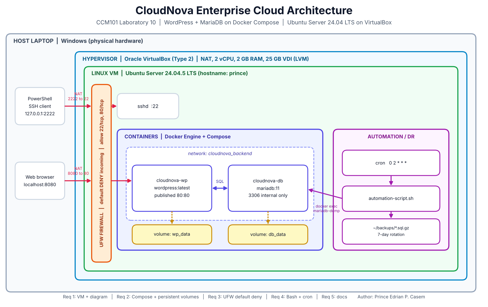
</p>

## ✨ Highlights

| | Feature | Details |
|---|---|---|
| 🧱 | **Infrastructure as Code** | One `docker-compose.yml` defines the whole stack |
| 💾 | **Persistent storage** | Named volumes `db_data` and `wp_data` survive reboots and container re-creation |
| 🔒 | **Hardened host** | UFW default deny; only SSH (22) and HTTP (80) allowed; database never published |
| 🤖 | **Self-managing backups** | `automation-script.sh` runs from cron daily at 02:00 and prunes backups older than 7 days |
| ♻️ | **Verified recovery** | A database backup was restored successfully and the site stayed online |
| 📚 | **Handover manual** | Deploy, secure, monitor, back up, restore and troubleshoot in `operational-manual.md` |

## 🗂️ Repository contents

```text
Laboratory-10-Enterprise-Cloud-Architect/
├── README.md                 ← you are here
├── architecture-diagram.png  ← host, hypervisor, VM, firewall, containers
├── docker-compose.yml        ← WordPress + MariaDB stack
├── automation-script.sh      ← DB backup with 7-day rotation
├── operational-manual.md     ← handover manual for the client's IT team
├── final-reflection.md       ← journey from Mission 1 to Mission 10
├── .env.example              ← template for secrets (copy to .env)
├── .gitignore                ← keeps .env and backups out of Git
└── screenshots/              ← evidence of every requirement
```

## ✅ Requirements at a glance

| # | Requirement | How it is met |
|---|-------------|---------------|
| 1 | Base infrastructure and diagram | Ubuntu Server 24.04.5 LTS VM in VirtualBox with NAT port forwarding (8080→80, 2222→22); diagram above |
| 2 | Docker Compose, multi-tier, persistent volumes | WordPress + MariaDB on a private network; data verified after a VM reboot |
| 3 | UFW hardening | `deny incoming` by default; only `22/tcp` and `80/tcp` allowed |
| 4 | Bash automation and cron | Executable `automation-script.sh` scheduled with `0 2 * * *` |
| 5 | Documentation | This README, the operational manual and the final reflection |

## 🚀 Quick start

```bash
git clone https://github.com/prince793/YOUR-REPO-NAME.git
cd YOUR-REPO-NAME/Laboratory-10-Enterprise-Cloud-Architect

# 1. Create secrets (random passwords)
cat > .env <<EOF
MYSQL_ROOT_PASSWORD=$(openssl rand -hex 16)
MYSQL_PASSWORD=$(openssl rand -hex 16)
EOF

# 2. Launch the stack
docker compose up -d
docker compose ps

# 3. Make the backup script executable and test it
chmod +x automation-script.sh
./automation-script.sh && ls -lh ~/backups
```

Then open the site on port 80 of the server (on the lab VM, from the host: `http://localhost:8080`).
Everything else is in the [operational manual](operational-manual.md).

## 🔐 Security at a glance

- **Default-deny firewall** with only the ports that are actually needed
- **Database is not published**; it is reachable only from the WordPress container
- **No secrets in Git**: passwords live in `.env`, which is git-ignored
- **Least exposure**: Docker publishes a single port (`80`)

## 🖼️ Evidence

<details>
<summary><b>Requirement 1: Base infrastructure</b></summary>
<br>

**VirtualBox VM configuration**
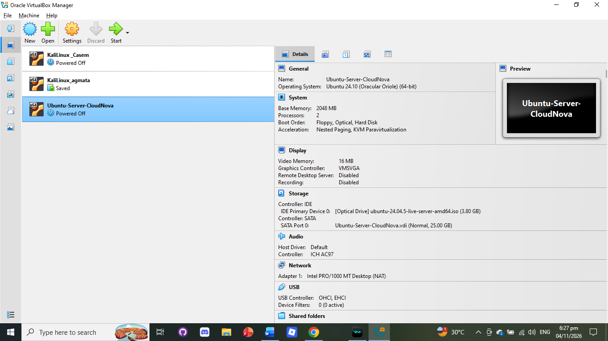

**NAT port forwarding rules (8080→80, 2222→22)**
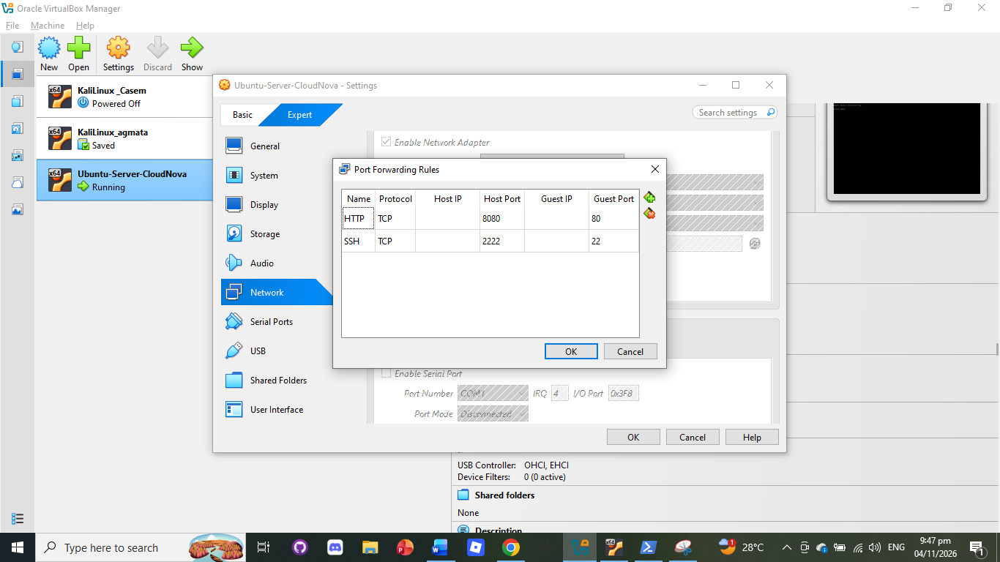

**Ubuntu Server installer, guided storage**
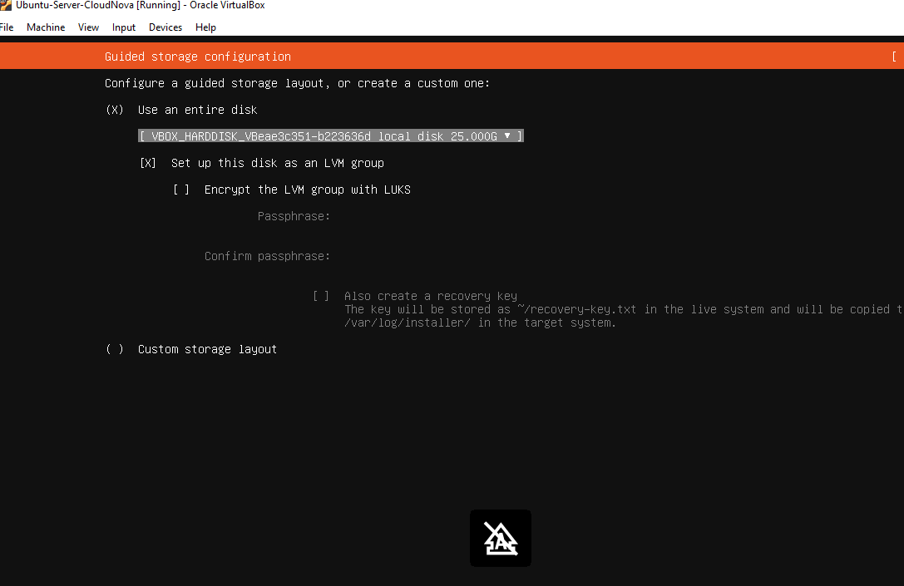

**SSH login from the host**
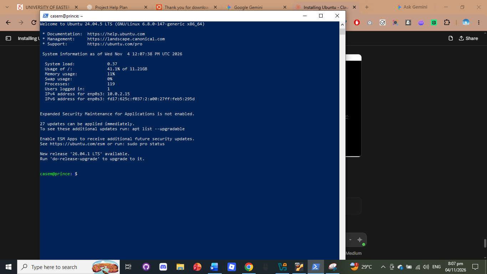

**Root volume extended to use the whole disk**
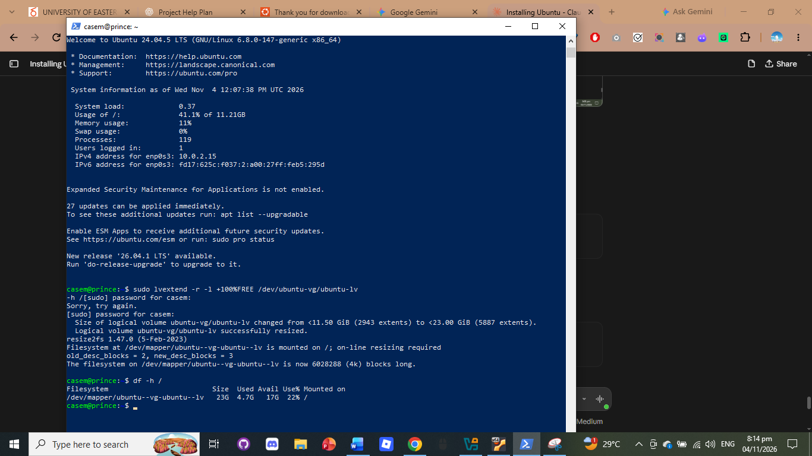

**Network interfaces, including the Docker bridge for `cloudnova_backend`**
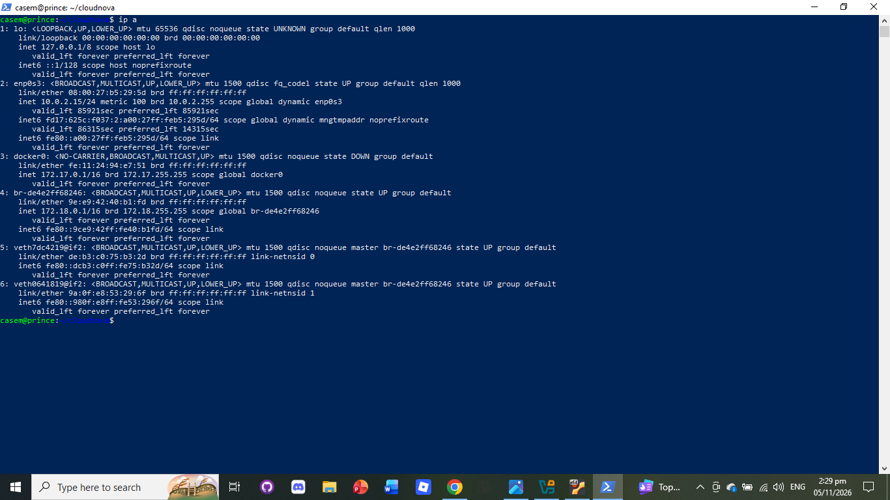

</details>

<details>
<summary><b>Requirement 2: Docker Compose and persistent volumes</b></summary>
<br>

**Docker and Compose installed**
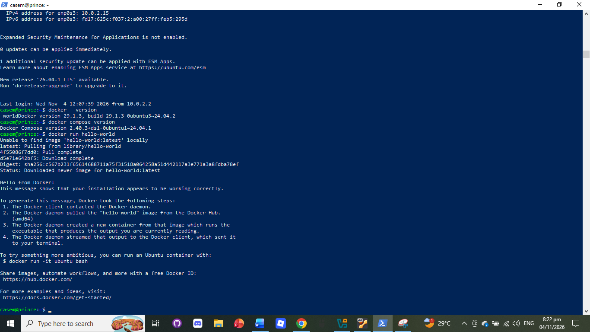

**The Compose file**
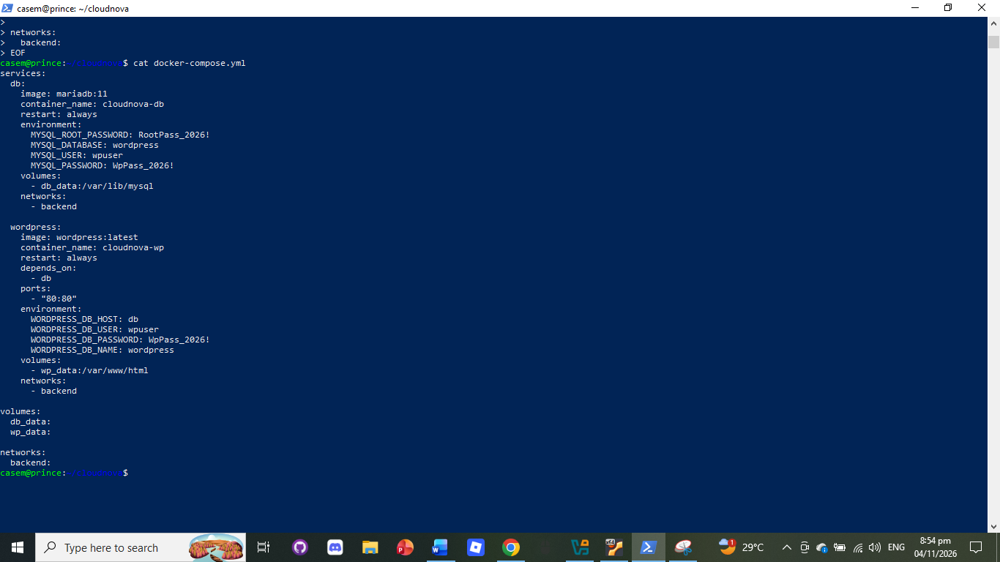

**Stack running with named volumes**
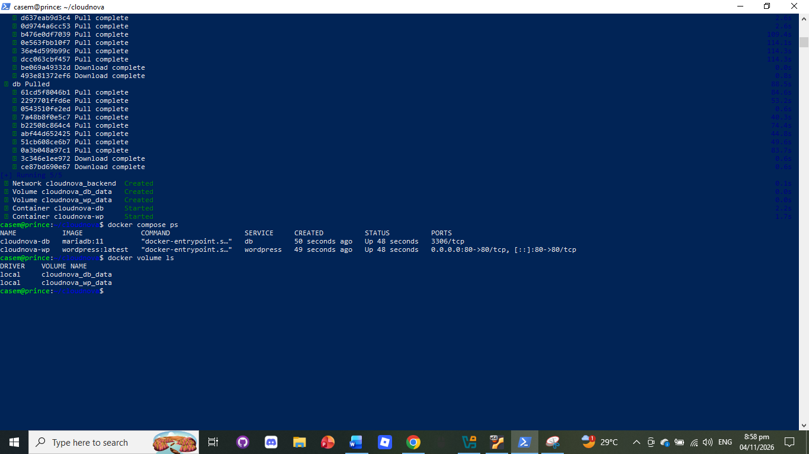

**WordPress dashboard**
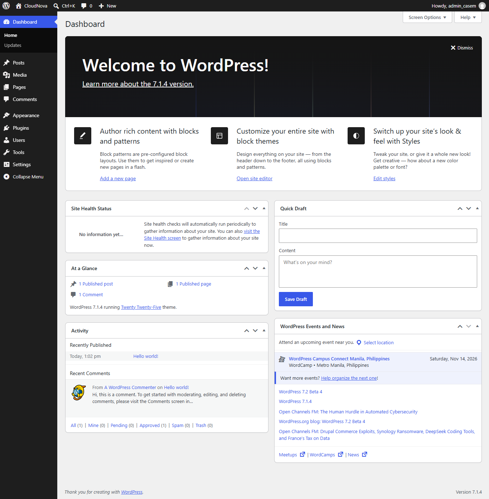

**Test post published**
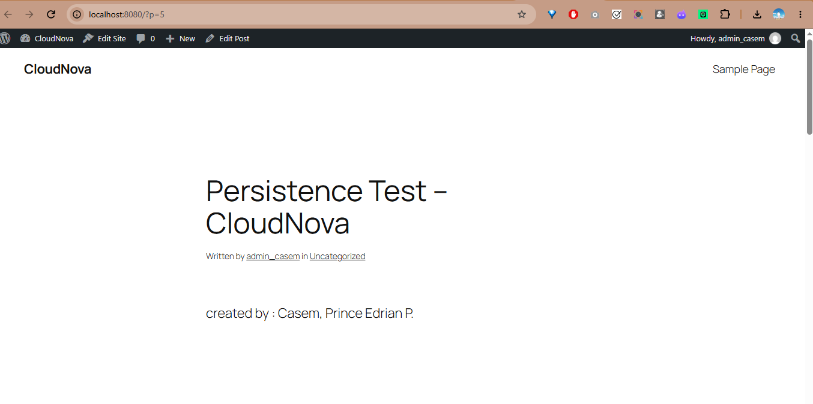

**After a VM reboot: containers restarted automatically**
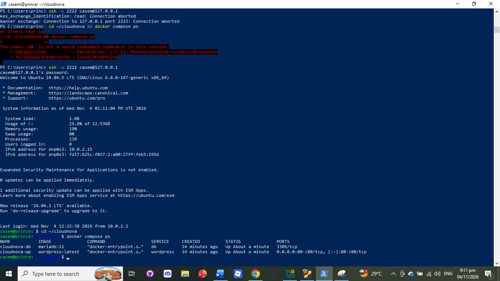

</details>

<details>
<summary><b>Requirement 3: Security (UFW)</b></summary>
<br>

**Firewall active, default deny, only SSH and HTTP allowed**
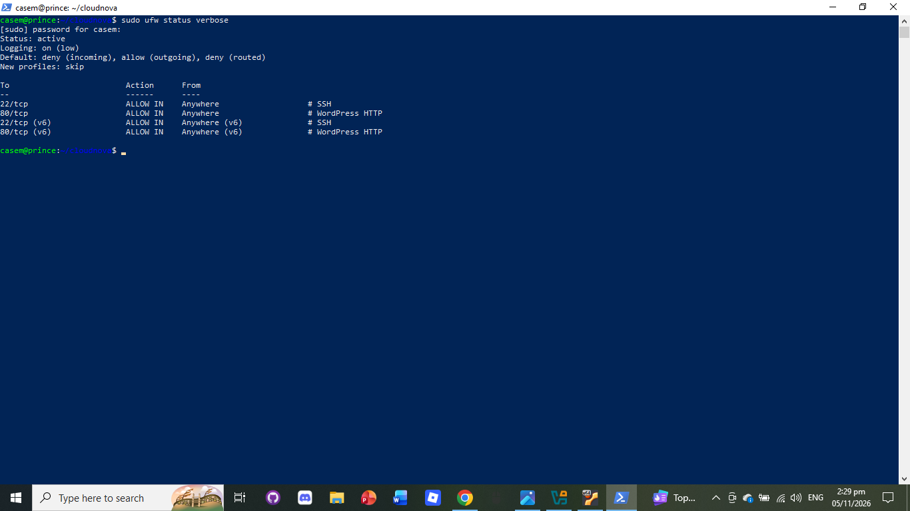

</details>

<details>
<summary><b>Requirement 4: Automation (Bash and cron)</b></summary>
<br>

**Executable script, cron schedule and automatically created backups**
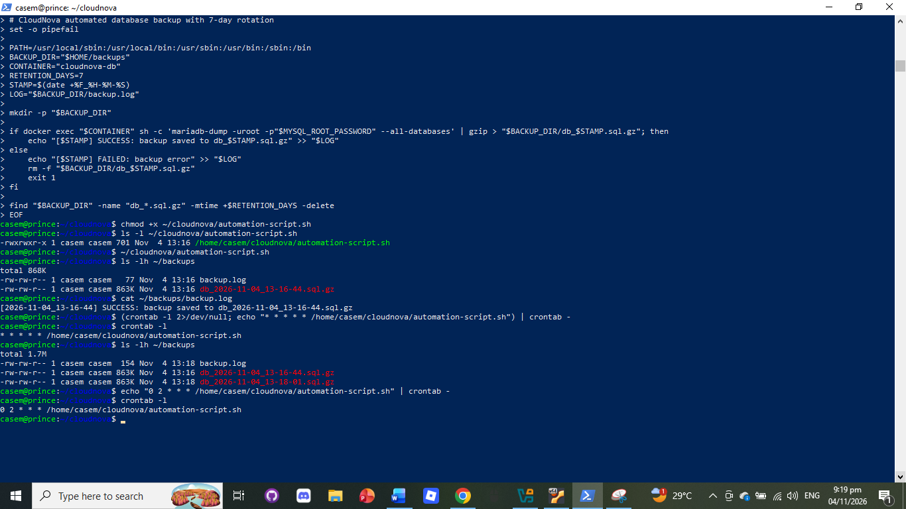

**Final crontab entry and server timezone**
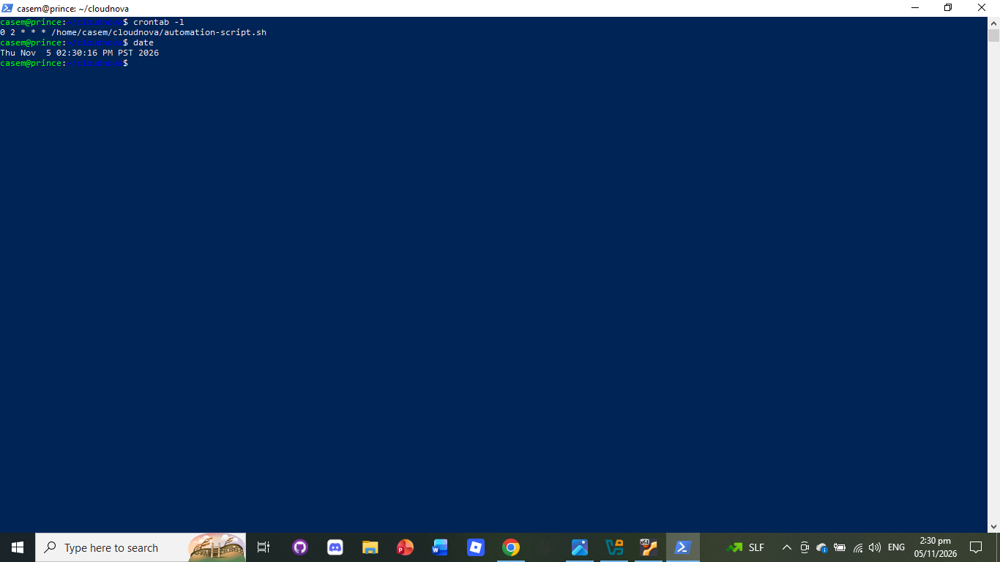

**Database restore test**


**Site still online and data intact after the restore**
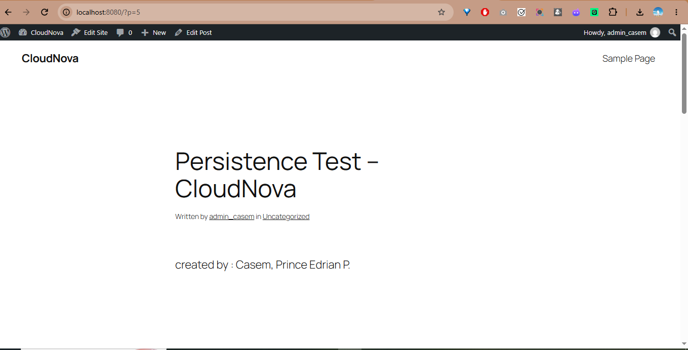

</details>

## 👤 Author

**Prince Edrian P. Casem**
BSIT 4-M · University of Eastern Pangasinan
CCM101 Cloud Computing, November 2026
