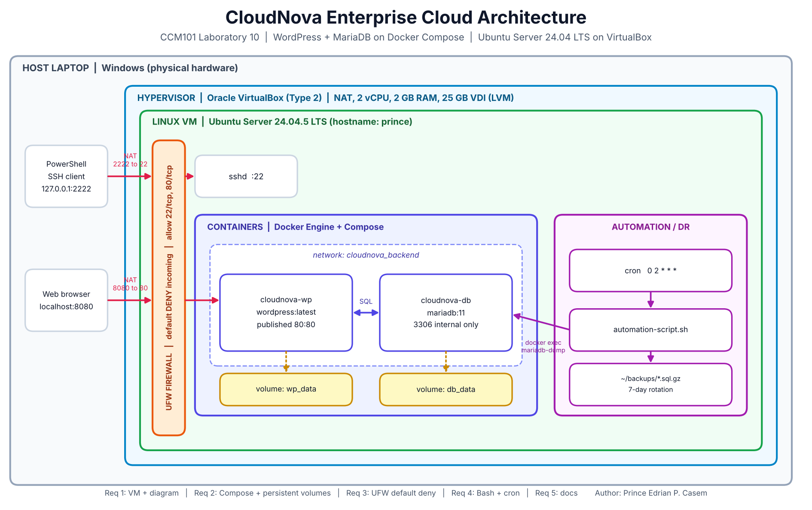

# 📘 CloudNova Operational Manual

**Handover document for the client's IT team**
Stack: WordPress + MariaDB on Docker Compose · Ubuntu Server 24.04 LTS · VirtualBox
Author: Prince Edrian P. Casem · CCM101 Laboratory 10

> [!NOTE]
> This manual explains how to **deploy**, **secure**, **operate**, **back up** and **recover** the CloudNova platform. All commands were run on the lab VM and the results are shown in the `screenshots/` folder.

## Table of contents

1. [Architecture summary](#1-architecture-summary)
2. [Quick reference](#2-quick-reference)
3. [Deployment](#3-deployment)
4. [Security hardening](#4-security-hardening)
5. [Operations and monitoring](#5-operations-and-monitoring)
6. [Backup automation](#6-backup-automation)
7. [Disaster recovery](#7-disaster-recovery)
8. [Troubleshooting](#8-troubleshooting)
9. [Live deployment runbook (fresh instance)](#9-live-deployment-runbook-fresh-instance)
10. [Verification checklist](#10-verification-checklist)

---

## 1. Architecture summary



| Layer | Component | Notes |
|-------|-----------|-------|
| Host | Windows laptop | Runs VirtualBox, the browser and the SSH client |
| Hypervisor | Oracle VirtualBox (Type 2) | NAT networking, 2 vCPU, 2 GB RAM, 25 GB disk |
| OS | Ubuntu Server 24.04.5 LTS | Headless, OpenSSH enabled, LVM root volume |
| Firewall | UFW | Default deny incoming; allow 22/tcp and 80/tcp |
| Containers | `cloudnova-wp` (WordPress), `cloudnova-db` (MariaDB 11) | Private network `cloudnova_backend` |
| Storage | Volumes `db_data`, `wp_data` | Survive container re-creation and VM reboots |
| Automation | `automation-script.sh` + cron | Daily compressed DB backup, 7-day rotation |

> [!IMPORTANT]
> The database publishes **no ports**. Only WordPress (port 80) is reachable from outside.

## 2. Quick reference

| What | Value |
|------|-------|
| SSH from host | `ssh -p 2222 <user>@127.0.0.1` |
| Website from host | `http://localhost:8080` |
| Project folder on the VM | `~/cloudnova` |
| Backups | `~/backups/db_<timestamp>.sql.gz` |
| Backup log | `~/backups/backup.log` |
| Backup schedule | `0 2 * * *` (02:00 server time, Asia/Manila) |
| Retention | 7 days |
| Containers | `cloudnova-wp`, `cloudnova-db` |
| Volumes | `cloudnova_wp_data`, `cloudnova_db_data` |

## 3. Deployment

### 3.1 Provision the VM (VirtualBox)

1. Create a VM: Linux / Ubuntu (64-bit), **2048 MB RAM**, **2 CPUs**, **25 GB** VDI.
2. Attach the Ubuntu Server 24.04 LTS live-server ISO.
3. Network: **NAT**, then *Advanced → Port Forwarding*:

| Name | Protocol | Host port | Guest port |
|------|----------|-----------|------------|
| SSH | TCP | 2222 | 22 |
| HTTP | TCP | 8080 | 80 |

4. Install with the defaults (entire disk with LVM, no encryption), create your user, and tick **Install OpenSSH server**. Skip the featured snaps.
5. After the first boot, extend the root volume to use the whole disk. The installer leaves about half of it unallocated.

```bash
sudo lvextend -r -l +100%FREE /dev/ubuntu-vg/ubuntu-lv
df -h /
```

6. Update the system and set the timezone:

```bash
sudo apt update && sudo apt upgrade -y
sudo timedatectl set-timezone Asia/Manila
sudo systemctl restart cron
```

7. Connect from the host: `ssh -p 2222 <user>@127.0.0.1`

### 3.2 Install Docker and Compose

```bash
sudo apt install -y docker.io docker-compose-v2
sudo usermod -aG docker $USER
# log out and back in, then verify
docker --version
docker compose version
docker run hello-world
```

### 3.3 Deploy the stack

```bash
git clone https://github.com/prince793/YOUR-REPO-NAME.git
cd YOUR-REPO-NAME/Laboratory-10-Enterprise-Cloud-Architect

# Create the secrets file with random passwords
cat > .env <<EOF
MYSQL_ROOT_PASSWORD=$(openssl rand -hex 16)
MYSQL_PASSWORD=$(openssl rand -hex 16)
EOF

docker compose up -d
docker compose ps
```

Both containers must show `Up`. Browse to `http://localhost:8080` (on the lab VM through port forwarding) and complete the WordPress installer.

> [!WARNING]
> The database credentials are only read when the database volume is **first created**. Changing `.env` later does not change the password of an existing database.

### 3.4 Verify persistence

1. Publish a post in WordPress.
2. Run `sudo reboot`, wait 1 to 2 minutes, and SSH back in.
3. `docker compose ps` shows both containers `Up` without any manual action (`restart: always`).
4. Reload the site. The post is still there because the data lives in the named volumes.

## 4. Security hardening

### 4.1 Firewall (UFW)

> [!CAUTION]
> Allow SSH **before** enabling the firewall, otherwise you will lock yourself out.

```bash
sudo ufw default deny incoming
sudo ufw default allow outgoing
sudo ufw allow 22/tcp comment 'SSH'
sudo ufw allow 80/tcp comment 'WordPress HTTP'
sudo ufw enable
sudo ufw status verbose
```

Expected result: `Default: deny (incoming), allow (outgoing)` with only `22/tcp` and `80/tcp` allowed.

> [!TIP]
> Open only ports that a service really listens on inside the VM. Host-side port 8080 is a VirtualBox forwarding port and does not need a rule in the VM.

### 4.2 Docker and the firewall

Docker publishes container ports by writing its own iptables rules, and traffic to published ports is not filtered by UFW's normal `allow` and `deny` rules. Therefore:

- **Publish only what must be public.** Here only WordPress (`80:80`) is published.
- **Keep the database unpublished.** It is reachable only by containers on `cloudnova_backend`.
- If an internal service must be published, bind it to localhost, for example `"127.0.0.1:3306:3306"`.
- For strict filtering of published ports, add rules to the `DOCKER-USER` chain.

### 4.3 Other practices

- Secrets are kept in `.env`, which `.gitignore` excludes from Git.
- Use a non-default WordPress admin username and a strong generated password.
- Keep packages current with `sudo apt update && sudo apt upgrade -y`.
- For production, use SSH keys and disable password login.

## 5. Operations and monitoring

| Task | Command |
|------|---------|
| Container status | `docker compose ps` |
| Follow logs | `docker compose logs -f wordpress` or `docker compose logs -f db` |
| Restart the stack | `docker compose restart` |
| Stop and start | `docker compose down` then `docker compose up -d` |
| Resource usage | `docker stats --no-stream` |
| Disk space | `df -h /` and `docker system df` |
| Firewall rules | `sudo ufw status verbose` |
| Backup history | `tail ~/backups/backup.log` |
| Update images | `docker compose pull && docker compose up -d` |

> [!WARNING]
> `docker compose down` keeps the volumes. `docker compose down -v` **deletes them and all data**. Never use `-v` unless that is the intent.

## 6. Backup automation

`automation-script.sh` runs `mariadb-dump --all-databases` inside `cloudnova-db`, compresses the output to `~/backups/db_<timestamp>.sql.gz`, logs `SUCCESS` or `FAILED` to `~/backups/backup.log`, and deletes backups older than 7 days. The root password is read from the container's own environment, so it is never stored in the script.

```bash
chmod +x automation-script.sh      # required once after cloning
./automation-script.sh             # manual test
ls -lh ~/backups
cat ~/backups/backup.log
```

### Schedule with cron

```bash
crontab -e
```

Add this line (daily at 02:00 server time, absolute path required):

```text
0 2 * * * /home/<user>/cloudnova/automation-script.sh
```

Check it with `crontab -l`.

> [!TIP]
> To demonstrate the schedule quickly, temporarily use `* * * * *` (every minute), confirm that new files appear in `~/backups`, then put the real schedule back.

## 7. Disaster recovery

### Restore the database from a backup

```bash
cd ~/cloudnova
gunzip -c ~/backups/db_<timestamp>.sql.gz | docker exec -i cloudnova-db sh -c 'mariadb -uroot -p"$MYSQL_ROOT_PASSWORD"'
docker compose restart wordpress
```

This procedure was tested on the lab VM: the restore completed without errors and the site stayed online with its data intact.

### Rebuild on a new server

1. Provision Ubuntu Server and install Docker (section 3).
2. Clone the repository, create `.env`, and run `docker compose up -d`.
3. Restore the latest `.sql.gz` backup as shown above.
4. Re-apply the UFW rules (section 4.1) and the cron job (section 6).

## 8. Troubleshooting

| Symptom | Cause and fix |
|---------|---------------|
| Black screen after reboot in VirtualBox | Wait 1 to 2 minutes for the first boot. If it persists, power off, set *Display → Graphics Controller* to VBoxVGA or VBoxSVGA, and remove the ISO from *Storage* |
| `ssh: Connection aborted` | OpenSSH is not running. Run `sudo apt install -y openssh-server` then `sudo systemctl enable --now ssh` |
| `ssh: Connection refused` | The port-forwarding rule is missing or the VM is not running |
| SSH session freezes after idling | Connect with `ssh -o ServerAliveInterval=30 -p 2222 <user>@127.0.0.1` |
| `permission denied` when running docker | Log out and back in after `usermod -aG docker $USER` |
| Site shows a database connection error | Run `docker compose ps` and `docker compose logs db`; make sure `.env` matches the credentials used when the volume was first created |
| Root filesystem only about 11 GB | Run the `lvextend` command from section 3.1 |
| Cron job runs at the wrong hour | Check `date`, set the timezone, then `sudo systemctl restart cron` |
| Cron job does not run | Check `crontab -l`, make sure the script is executable with `chmod +x` and uses absolute paths, then read `backup.log` |

## 9. Live deployment runbook (fresh instance)

For the live defense on a fresh KillerCoda instance:

```bash
docker --version && docker compose version     # install if missing
git clone https://github.com/prince793/YOUR-REPO-NAME.git
cd YOUR-REPO-NAME/Laboratory-10-Enterprise-Cloud-Architect
cat > .env <<EOF
MYSQL_ROOT_PASSWORD=$(openssl rand -hex 16)
MYSQL_PASSWORD=$(openssl rand -hex 16)
EOF
docker compose up -d
docker compose ps
curl -I http://localhost
chmod +x automation-script.sh
./automation-script.sh && ls -lh ~/backups
```

**Talking points while it runs**

1. **Design:** two tiers on a private network, one published port, data in volumes.
2. **Persistence:** named volumes keep data when containers are re-created or the VM reboots.
3. **Security:** default-deny firewall, unpublished database, secrets outside Git, and the Docker versus UFW behaviour explained in section 4.2.
4. **Automation:** cron runs the backup daily and rotation keeps seven days.
5. **Recovery:** a tested restore procedure rebuilds the data on any server.

> [!CAUTION]
> Practice this beforehand. If you enable UFW on a shared lab instance, allow SSH first and confirm how the web terminal connects before turning the firewall on.

## 10. Verification checklist

| Check | Command | Expected |
|-------|---------|----------|
| OS version | `lsb_release -a` | Ubuntu 24.04 LTS |
| Disk | `df -h /` | About 23 GB total |
| Containers | `docker compose ps` | `cloudnova-wp` and `cloudnova-db` are `Up` |
| Volumes | `docker volume ls` | `cloudnova_db_data`, `cloudnova_wp_data` |
| Firewall | `sudo ufw status verbose` | Active, default deny incoming, 22 and 80 only |
| Script | `ls -l automation-script.sh` | Has the `x` permission |
| Cron | `crontab -l` | `0 2 * * * .../automation-script.sh` |
| Backups | `ls -lh ~/backups` | `.sql.gz` files and `backup.log` |
| Persistence | `sudo reboot`, then reload the site | Containers back up, post still present |
